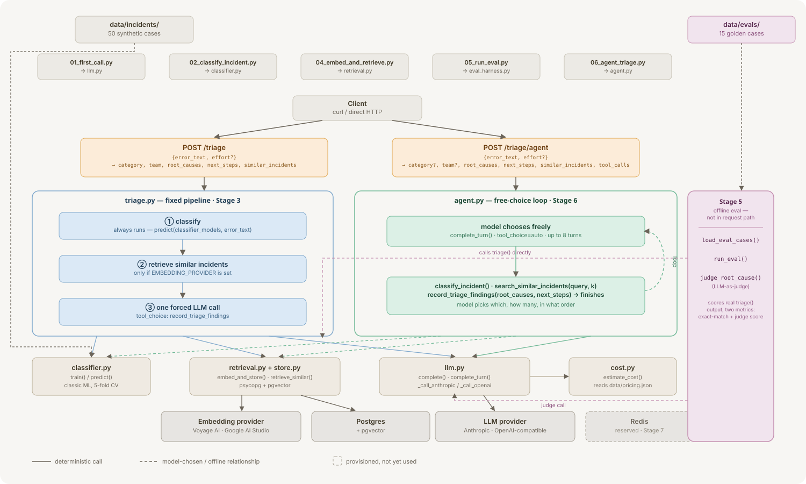

# Incident Copilot

An AI assistant that helps on-call engineers triage production incidents. Paste an error or log snippet, and it finds similar past incidents and runbooks, suggests a likely root cause with citations, and drafts next steps.

Built stage by stage as a hands-on way to learn AI engineering. All data is synthetic.

## Architecture



Two request paths share the same core. `POST /triage` (Stage 3) runs a fixed
classify → retrieve → LLM pipeline, every call in the same order. `POST /triage/agent`
(Stage 6) lets the model freely choose which of three tools to call, in what order, across
multiple turns. Both land on the same classifier, retrieval and LLM modules underneath,
which in turn talk to the external providers. Stage 5's eval harness scores real `triage()`
output against a golden set offline - it's not part of either request path. Current as of
Stage 6; Stage 7 (redaction, guardrails, cost) isn't reflected yet.

## Stages

| Stage | Topic | Status |
| --- | --- | --- |
| 1 | How LLMs work, first API call | Done |
| 2 | Classic ML baseline classifier | Done |
| 3 | Prompting and structured output (`POST /triage`) | Done |
| 4 | Embeddings and retrieval (RAG) with pgvector | Done |
| 5 | Evaluation, run in CI | Done |
| 6 | Tools and agents | In Progress |
| 7 | Production readiness: redaction, guardrails, cost | TO-DO |

Decisions are recorded in [docs/decisions](docs/decisions).

## Setup

```bash
uv sync                      # install dependencies
cp .env.example .env         # then set LLM_PROVIDER, LLM_MODEL and LLM_API_KEY
uv run pytest                # run tests
uv run uvicorn copilot.api:app --reload   # start the API at http://localhost:8000
```

`LLM_PROVIDER`, `LLM_MODEL` and `LLM_API_KEY` are all required - the app fails at startup
if any is missing. There is no default provider or model for either Anthropic or OpenAI;
pick one yourself and verify the model name is current against the provider's own docs.

Later stages need Postgres and Redis: `docker compose up -d`.

## Stage 1

```bash
uv run --env-file .env python stages/01_first_call.py "ERROR PaymentService: duplicate transaction id TXN-123"

# compare a higher effort level or a cheaper model, without editing code
uv run --env-file .env python stages/01_first_call.py --effort medium "ERROR PaymentService: duplicate transaction id TXN-123"
uv run --env-file .env python stages/01_first_call.py --model claude-sonnet-5-5 "ERROR PaymentService: duplicate transaction id TXN-123"

# use OpenAI instead of Anthropic for this one call (no default model - use one you've configured)
uv run --env-file .env python stages/01_first_call.py --provider openai --model <the model you've configured> "ERROR PaymentService: duplicate transaction id TXN-123"
```

## Stage 2

```bash
# evaluate: 5-fold cross-validated accuracy on the 50 synthetic incidents
uv run python stages/02_classify_incident.py

# predict category + team for a new error message
uv run python stages/02_classify_incident.py "ERROR PaymentGateway: timeout calling StripeAPI charge endpoint"
```

## Stage 3

Needs a real `LLM_API_KEY` in `.env` (unlike Stage 2, which needs no API key). `/triage`
honors the same `LLM_PROVIDER`/`LLM_MODEL` config as Stage 1 - switching providers means
editing `.env` and restarting the API (provider/model are validated once, at startup).
The request body also accepts an optional `"effort"` field (Anthropic only), falling
back to `LLM_EFFORT` from `.env`, then `"low"`.

```bash
uv run uvicorn copilot.api:app --reload   # starts the API, training the classifier once at startup

curl -X POST http://localhost:8000/triage \
  -H "Content-Type: application/json" \
  -d '{"error_text": "ERROR PaymentGateway: timeout calling StripeAPI charge endpoint"}'
```

## Stage 4

Needs Postgres running (`docker compose up -d`) and `EMBEDDING_PROVIDER`/`EMBEDDING_MODEL`/
`EMBEDDING_API_KEY` set in `.env` - optional unlike Stage 1-3's `LLM_*` vars, since Stages 1-3
don't need them. See decision
[0006](docs/decisions/0006-stage4-embedding-provider.md) for the provider choice
(Voyage AI primary, Google AI Studio second). Once embeddings are configured, `/triage`
automatically retrieves similar past incidents and includes them (with citations, as
`similar_incidents` in the response) as grounding context for the LLM call - no separate
endpoint or flag needed.

```bash
docker compose up -d                      # starts Postgres with the pgvector extension

# backfill: embed and store every incident in data/incidents/ (idempotent, safe to re-run)
uv run --env-file .env python stages/04_embed_and_retrieve.py

# retrieve: print the k most similar stored incidents to a new error message
uv run --env-file .env python stages/04_embed_and_retrieve.py "ERROR PaymentGateway: timeout calling StripeAPI charge endpoint"
```

## Stage 5

Scores real `triage()` output against the hand-labeled golden set in `data/evals/` (15
synthetic cases) - `category`/`team` by exact match against the real Stage 2 classifier,
`root_causes` quality by a second LLM call (an "LLM-as-judge") comparing the output against
each case's human-written expected root cause. See decision
[0007](docs/decisions/0007-stage5-eval-harness.md). `uv run pytest` verifies the scoring
harness itself with a mocked LLM (free, runs in CI); the real scored run below makes two real
LLM calls per case and is manual/opt-in, like Stage 1/3's real-API checks.

```bash
uv run --env-file .env python stages/05_run_eval.py
```

## Stage 6

An actual agent loop, not a fixed pipeline: the model is offered three tools -
`classify_incident`, `search_similar_incidents`, `record_triage_findings` - with free
choice, and decides itself which to call, in what order, how many times, until it calls
`record_triage_findings` to finish. See decision
[0008](docs/decisions/0008-stage6-tool-use-agent-loop.md). Unlike `/triage`,
`category`/`team` and retrieval usage are no longer guaranteed - they only happen if the
model chooses to call the corresponding tool. The CLI prints the tool-call trace before the
final answer, since watching what the model decided to do is the point of this stage.

```bash
uv run --env-file .env python stages/06_agent_triage.py "ERROR PaymentGateway: timeout calling StripeAPI charge endpoint"

# give the agent a smaller turn budget, or more room to explore
uv run --env-file .env python stages/06_agent_triage.py --max-turns 4 "..."
```

`POST /triage/agent` (same request body as `/triage`) exposes the same loop over HTTP, with
`category`/`team` nullable and a `tool_calls` field showing the trace:

```bash
uv run uvicorn copilot.api:app --reload

curl -X POST http://localhost:8000/triage/agent \
  -H "Content-Type: application/json" \
  -d '{"error_text": "ERROR PaymentGateway: timeout calling StripeAPI charge endpoint"}'
```
